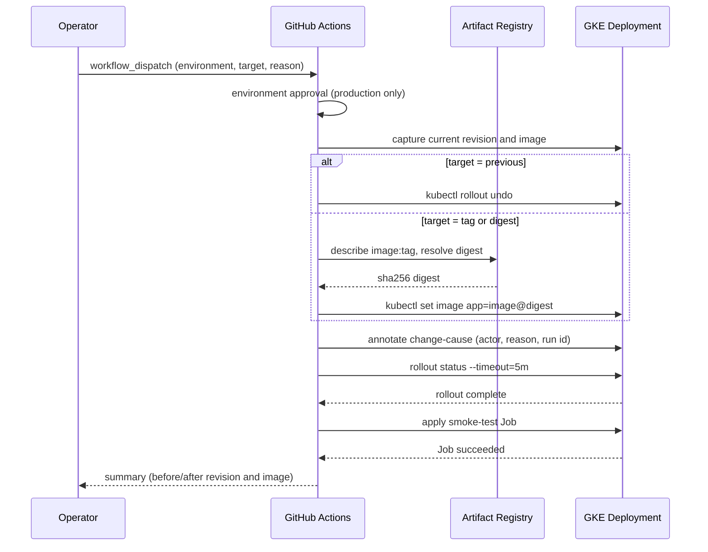

# github-actions-devsecops

End-to-end DevSecOps delivery pipeline on GitHub Actions: tests, SonarCloud, Trivy, hardened multi-stage Docker builds, Artifact Registry via OIDC, and gated UAT/production deployments to GKE with rollback.


## Project Overview

This repository implements a complete build-scan-deploy pipeline for a containerised Node.js service. Every change is linted, unit-tested, analysed by SonarCloud, scanned by Trivy (source tree and image), built into a distroless non-root image, and pushed to Artifact Registry using short-lived OIDC credentials. The same immutable digest is then deployed to a UAT GKE cluster automatically and promoted to production behind a GitHub environment approval gate, with automatic rollback on failed rollouts and a manual rollback workflow.

> **Scope note:** This is a personal reference implementation built to demonstrate production-grade patterns I use professionally. It is not the production code of any employer, and all project IDs, domains, IPs, and data are placeholders or synthetic.

## Problem Statement

Teams that adopt GitHub Actions for delivery frequently end up with pipelines that push images tagged `latest`, authenticate to the cloud with long-lived JSON keys stored as secrets, rebuild the image separately for each environment, run security scanners in advisory mode only, and have no rehearsed path back when a deploy goes wrong. Each of those shortcuts is individually small; together they make it impossible to answer basic questions such as "which commit is running in production", "was this artefact scanned before it shipped", and "how do we get back to the previous version in under five minutes".

This repository shows one coherent answer: build once, scan and attest the artefact, deploy by digest, gate production on human approval, and treat rollback as a tested workflow rather than an emergency procedure.

## Architecture

The pipeline is split into four triggered workflows and two reusable workflows.

- `pr-validation.yml` runs cluster-free checks on every pull request: Conventional Commits title, `actionlint`, Kustomize render, `kubeconform` schema validation, and a Trivy configuration scan of the manifests.
- `ci.yml` runs on pull requests and pushes to `main`: lint, unit tests with coverage, SonarCloud with quality gate wait, Trivy filesystem scan (vulnerabilities, secrets, misconfigurations), hadolint, an image build that is loaded but never pushed, a container smoke test that also asserts the UID and clean SIGTERM handling, and a Trivy image scan. SARIF from every scanner is uploaded to code scanning before the gate is enforced.
- `cd.yml` runs on pushes to `main` and semver tags. It calls `reusable-docker-build-push.yml`, which authenticates to GCP through Workload Identity Federation, builds with Buildx, tags with `sha-<short>` (plus semver on tags), pushes with SLSA provenance and SBOM attestations, and re-scans the pushed digest. The digest is passed to `reusable-deploy-gke.yml` twice: once for the `uat` environment and, after approval, once for `production`.
- `reusable-deploy-gke.yml` obtains cluster credentials with `get-gke-credentials@v2`, pins the digest with `kustomize edit set image`, performs a server-side dry run, applies, annotates the change cause, waits for `rollout status`, runs an in-cluster smoke Job against the Service, and executes `kubectl rollout undo` automatically if either the rollout or the smoke test fails.
- `rollback.yml` is a `workflow_dispatch` that rolls an environment back to the previous revision or to any tag/digest that already exists in the registry.

The application itself is a small Express service with `/healthz`, `/readyz`, `/api/v1/hello` and `/metrics` (Prometheus) that flips readiness to 503 before draining on SIGTERM. Kubernetes manifests are Kustomize base plus `uat` and `prod` overlays and follow restricted Pod Security Standards. In a full platform the Service sits behind an Istio ingress gateway fronted by a Google Cloud external load balancer with Cloud Armor; those components live in separate infrastructure repositories and are shown in the diagram for context.

## Architecture Diagram

```mermaid
flowchart LR
    Dev["Developer"] -->|"git push / PR"| GH["GitHub repository"]
    GH --> GA["GitHub Actions"]

    subgraph CI["CI: ci.yml and pr-validation.yml"]
        direction LR
        Lint["Lint and unit tests"] --> Sonar["SonarCloud quality gate"]
        Sonar --> TrivyFS["Trivy fs scan"]
        TrivyFS --> Hado["hadolint"]
        Hado --> Build["Docker build (multi-stage, distroless)"]
        Build --> TrivyImg["Trivy image scan"]
    end

    subgraph CD["CD: cd.yml"]
        direction LR
        Push["Build and push via OIDC"] --> AR["Artifact Registry (digest, SBOM, provenance)"]
        AR --> UAT["Deploy UAT (auto)"]
        UAT --> Gate{"Approval gate: production environment"}
        Gate -->|"approved"| Prod["Deploy production (same digest)"]
    end

    GA --> Lint
    TrivyImg -->|"merge to main"| Push
    UAT -. "rollout undo on failure" .-> UAT
    Prod -. "rollout undo on failure" .-> Prod

    subgraph GKE["GKE production"]
        direction LR
        Prod --> Deploy["Deployment + HPA + PDB + NetworkPolicy"]
        Deploy --> Istio["Istio ingress gateway"]
    end

    Istio --> LB["Cloud Load Balancing + Cloud Armor"]
    LB --> Users["Users"]

    WIF["Workload Identity Federation"] -. "short-lived tokens" .-> Push
    WIF -. "short-lived tokens" .-> UAT
    WIF -. "short-lived tokens" .-> Prod
```



Rollback sequence (`rollback.yml`):



## Technology Stack

| Layer | Technology | Purpose |
|---|---|---|
| CI/CD | GitHub Actions, reusable workflows, environments | Orchestration, approval gates, OIDC identity |
| Application | Node.js 20, Express 4, prom-client | Sample HTTP service with health, readiness and metrics endpoints |
| Testing | `node:test`, built-in `http` client, lcov coverage | Dependency-free unit and integration tests |
| Code quality | SonarCloud (`sonarqube-scan-action@v4`, quality gate action) | Static analysis, coverage tracking, quality gate |
| Vulnerability scanning | Trivy 0.28.0 action (fs, image, config), hadolint | CRITICAL/HIGH gating, secret detection, Dockerfile lint, SARIF to code scanning |
| Container | Docker Buildx, `gcr.io/distroless/nodejs20-debian12:nonroot` | Multi-stage, non-root, shell-less runtime image |
| Supply chain | `docker/metadata-action`, BuildKit SBOM and SLSA provenance | Immutable tags, OCI labels, attestations |
| Registry | Google Artifact Registry | Image storage; digest-pinned deploys |
| Identity | Workload Identity Federation, `google-github-actions/auth@v2` | Keyless authentication from GitHub to GCP |
| Orchestration | GKE, Kustomize 5, `kubectl`, `get-gke-credentials@v2` | Base + overlays, rollout management |
| Validation | kubeconform, actionlint, Trivy config, policy script | Manifest and workflow correctness before merge |
| Dependency hygiene | Dependabot (npm, docker, github-actions) | Weekly grouped updates |

## Repository Structure

```
github-actions-devsecops/
├── .github/
│   ├── CODEOWNERS
│   ├── dependabot.yml
│   ├── pull_request_template.md
│   └── workflows/
│       ├── ci.yml                          # PR + main: lint, tests, Sonar, Trivy, hadolint, build, image scan
│       ├── cd.yml                          # main + tags: build-push -> UAT -> approval -> production
│       ├── pr-validation.yml               # PR title, actionlint, kustomize, kubeconform, Trivy config
│       ├── rollback.yml                    # workflow_dispatch rollback (previous | tag | digest)
│       ├── reusable-docker-build-push.yml  # workflow_call: OIDC, buildx, metadata, attestations, scan
│       └── reusable-deploy-gke.yml         # workflow_call: kustomize set image, apply, rollout, smoke, undo
├── app/
│   ├── Dockerfile                          # deps stage -> distroless nonroot runtime
│   ├── .dockerignore
│   ├── package.json
│   ├── package-lock.json
│   ├── scripts/lint.js                     # dependency-free lint gate
│   └── src/
│       ├── app.js                          # Express app factory, metrics, security headers
│       ├── server.js                       # entrypoint, graceful SIGTERM drain
│       └── server.test.js                  # node:test suite using node:http
├── k8s/
│   ├── base/                               # Deployment, Service, SA, ConfigMap, HPA, PDB, NetworkPolicy
│   ├── overlays/
│   │   ├── uat/                            # namespace, replicas, resources, image registry
│   │   └── prod/                           # namespace, replicas, resources, PDB, hard zone spread
│   └── smoke-test-job.yaml                 # in-cluster smoke Job run after each deploy
├── docs/
│   ├── pipeline-design.md
│   ├── image-tagging-strategy.md
│   ├── rollback-strategy.md
│   ├── github-environments-setup.md
│   └── security-controls.md
├── scripts/
│   ├── kustomize-validate.sh               # render + kubeconform + repository policy checks
│   └── smoke-test.sh                       # HTTP smoke test for local or port-forwarded instances
├── .env.example
├── .gitignore
├── .hadolint.yaml
├── .trivyignore                            # empty by policy; suppressions need owner, reason, expiry
├── trivy.yaml                              # severity CRITICAL,HIGH; ignore-unfixed; exit-code 1
├── sonar-project.properties
├── Makefile
├── LICENSE
└── README.md
```

## Prerequisites

Local development:

- Node.js 20 or later and npm 10 or later
- Docker with Buildx (for `make build`, `make scan-image`, `make hadolint`)
- `kubectl` 1.28 or later (`kubectl kustomize` is used when the standalone `kustomize` binary is absent)
- Optional: `kubeconform` 0.6 or later, `trivy` 0.56 or later, `hadolint` 2.12 or later. The Makefile falls back to Docker images for Trivy and hadolint.

Cloud and GitHub (documented step by step in `docs/github-environments-setup.md`):

- A GCP project with Artifact Registry (Docker format) and one or more GKE clusters
- A Workload Identity Pool and GitHub OIDC provider restricted to this repository
- Dedicated service accounts for image push and for each deploy environment
- GitHub environments `uat` and `production` (the latter with required reviewers)
- A SonarCloud project and analysis token

## Installation

```bash
git clone https://github.com/deveshr17/github-actions-devsecops.git
cd github-actions-devsecops

# Application dependencies
make install

# Run every local gate: lint, tests, hadolint, image build, Trivy scans, manifest validation
make all
```

To run only the fast checks:

```bash
make lint test
make kustomize-validate
```

## Configuration

Application configuration is environment-variable based. Copy `.env.example` to `.env` for local runs; in Kubernetes the same keys are supplied by the `sample-service-config` ConfigMap (merged per overlay with `configMapGenerator`).

| Variable | Default | Description |
|---|---|---|
| `PORT` | `8080` | Listen port |
| `SERVICE_NAME` | `devsecops-sample-service` | Reported in `/api/v1/hello` and as a metrics label |
| `SERVICE_VERSION` | `0.0.0-dev` | Set from the image build arg `VERSION` |
| `GIT_SHA` | `unknown` | Set from the image build arg `GIT_SHA` |
| `DRAIN_DELAY_MS` | `5000` | Time between readiness flipping to 503 and closing the listener |
| `SHUTDOWN_TIMEOUT_MS` | `25000` | Hard deadline before forced exit; must be below `terminationGracePeriodSeconds` (35s) |

Pipeline configuration lives in GitHub:

| Kind | Name | Notes |
|---|---|---|
| Secret | `SONAR_TOKEN` | Repository scope |
| Secret | `WIF_PROVIDER`, `WIF_SERVICE_ACCOUNT`, `GCP_PROJECT_ID` | Repository scope for builds; `uat` and `production` environment scope for deploys |
| Variable | `ARTIFACT_REGISTRY_HOST`, `ARTIFACT_REGISTRY_REPO` | Default `asia-south1-docker.pkg.dev`, `apps` |
| Variable | `GKE_LOCATION`, `GKE_CLUSTER_UAT`, `GKE_CLUSTER_PROD` | Cluster coordinates |

Scanner policy is in `trivy.yaml` (severity, `ignore-unfixed`, scanners) and `.trivyignore` (empty by default; each suppression requires an owner, justification and expiry). Dockerfile lint policy is in `.hadolint.yaml`. SonarCloud project identity is in `sonar-project.properties`.

## Deployment

Automated flow (`cd.yml`):

1. Merge to `main` (or push a `v*.*.*` tag).
2. `build-push` authenticates via OIDC, builds, tags `sha-<short>` (and semver), pushes with SBOM and provenance, and scans the pushed digest.
3. `deploy-uat` pins the digest in `k8s/overlays/uat`, applies, waits for rollout, runs the smoke Job. Failure triggers `rollout undo`.
4. `deploy-production` waits for a reviewer on the `production` environment, then repeats step 3 against `k8s/overlays/prod` with the identical digest.

Manual deployment of a rendered overlay (for a workstation with cluster access):

```bash
gcloud container clusters get-credentials example-uat-gke --region asia-south1 --project example-project-dev
cd k8s/overlays/uat
kustomize edit set image sample-service=asia-south1-docker.pkg.dev/example-project-dev/apps/sample-service@sha256:<digest>
kubectl apply -k . --dry-run=server
kubectl apply -k .
kubectl -n sample-service-uat rollout status deploy/sample-service --timeout=5m
kubectl -n sample-service-uat apply -f ../../smoke-test-job.yaml
```

Rollback (`rollback.yml`): Actions tab, choose `environment`, set `target` to `previous`, a tag such as `sha-1a2b3c4`, or a `sha256:` digest, and give a `reason`. Details are in `docs/rollback-strategy.md`.

## CI/CD

| Workflow | Trigger | Key jobs | Gate |
|---|---|---|---|
| `pr-validation.yml` | PR opened/edited/synchronize | `pr-title`, `actionlint`, `kustomize-validate` (matrix uat, prod), `policy-checks` | Required status checks |
| `ci.yml` | PR to `main`, push to `main` | `lint-test`, `sonarcloud`, `trivy-fs`, `hadolint`, `build-and-scan-image`, `ci-status` | `ci-status` aggregates; Sonar skipped (not failed) on fork PRs |
| `cd.yml` | push `main`, tags `v*.*.*` | `build-push`, `deploy-uat`, `deploy-production` | `production` environment approval |
| `rollback.yml` | manual | `rollback` | Environment approval |

Design decisions that matter:

- **Scan twice, upload always.** Each Trivy stage runs once with `exit-code: 0` to emit SARIF and once with `exit-code: 1` to enforce policy, so findings reach the Security tab even when the build fails.
- **Build once, promote by digest.** Production never rebuilds. `reusable-deploy-gke.yml` rejects any image reference that is not a `sha256:` digest.
- **Concurrency.** CI cancels superseded runs per PR; CD serialises per ref without cancelling so a deploy is never interrupted mid-rollout.
- **Minimal permissions.** Workflow default `contents: read`; `id-token: write` only on jobs that call `google-github-actions/auth@v2`.
- **Reusable workflows.** Build and deploy logic is `workflow_call` so other services can consume it with different inputs.

Full stage-by-stage behaviour and failure policy: `docs/pipeline-design.md`.

## Security

Controls by layer (full list in `docs/security-controls.md`):

- **Identity:** Workload Identity Federation only; the provider's attribute condition restricts it to this repository and the deploy service accounts are bound per GitHub environment.
- **Pipeline:** pinned actions, Dependabot for actions/npm/docker, CODEOWNERS on workflows and manifests, `actionlint`, fork-safe CI, Trivy secret scanning.
- **Artefact:** hadolint, multi-stage build, distroless non-root runtime (UID 65532), Trivy image scan before push (CI) and after push (CD), SLSA provenance and SPDX SBOM attestations, OCI labels tying the image to a commit.
- **Runtime:** restricted Pod Security Standard namespaces, read-only root filesystem, dropped capabilities, `RuntimeDefault` seccomp, no service account token, default-deny NetworkPolicy with explicit ingress from the ingress gateway and monitoring, egress limited to DNS and Private Google Access.
- **Secrets:** referenced through `secretKeyRef`; the repository renders no `Secret` objects and the policy script fails if one appears.

## Monitoring

- `/metrics` exposes `http_requests_total`, `http_request_duration_seconds` (histogram) and Node.js process metrics via `prom-client`. Pods carry `prometheus.io/scrape` annotations and the NetworkPolicy admits the `monitoring` and `gmp-system` namespaces, so Google Managed Prometheus or a self-hosted Prometheus can scrape without further changes.
- `/healthz` (liveness), `/readyz` (readiness; returns 503 during drain) and a `startupProbe` on `/healthz` give the kubelet accurate signals during rollouts.
- Logs are single-line JSON on stdout/stderr and are collected by Cloud Logging on GKE without agents.
- Deploy traceability: `kubectl rollout history deploy/sample-service` shows a change-cause per revision containing tag, commit, actor and GitHub run ID. Each workflow run writes a step summary with digest, revisions and gate outcomes.
- Suggested alerts (defined in a monitoring repository, not here): 5xx ratio above 1 percent for 5 minutes, p95 latency above 500 ms, `kube_deployment_status_replicas_unavailable > 0` for 10 minutes, HPA at `maxReplicas` for 15 minutes.

## Troubleshooting

| Symptom | Likely cause | How to check | Fix |
|---|---|---|---|
| `google-github-actions/auth` fails with `Permission 'iam.serviceAccounts.getAccessToken' denied` | Pool principal not bound to the service account, or attribute condition rejects the repo/environment | Compare the `principalSet://...attribute.repository/...` binding with `gcloud iam service-accounts get-iam-policy` | Add the `roles/iam.workloadIdentityUser` binding for the correct attribute; confirm the job has `id-token: write` |
| `docker/login-action` to Artifact Registry returns 403 | Service account lacks `roles/artifactregistry.writer` on the repository | `gcloud artifacts repositories get-iam-policy apps --location=asia-south1` | Grant the role on the repository, not the project |
| Trivy gate fails but Security tab shows nothing | SARIF step ran after the gate and was skipped | Check step order and `if: always()` on the upload | Keep the SARIF pass before the gate pass as in `ci.yml` |
| SonarCloud step fails with `Automatic Analysis is enabled` | Both CI-based and automatic analysis configured | SonarCloud project Administration > Analysis Method | Disable Automatic Analysis |
| `kubectl rollout status` times out, pods `CrashLoopBackOff` | Application cannot start (bad env, port mismatch) | `kubectl -n <ns> logs deploy/sample-service --previous` | Fix config; the workflow already rolled back to the previous revision |
| Pods `Running` but never `Ready`; rollout stalls | Readiness probe path or port wrong, or NetworkPolicy blocks kubelet | `kubectl describe pod` events; probes are exempt from NetworkPolicy so check the path | Correct probe path/port; check `containerPort` name `http` |
| Smoke Job fails with connection refused | Service selector mismatch or NetworkPolicy rejecting same-namespace traffic | `kubectl -n <ns> get endpoints sample-service`; review `sample-service-allow-ingress` | Ensure labels rendered by `labels.includeSelectors` match; keep the `podSelector: {}` ingress rule |
| `kustomize edit set image` has no effect | Image name in the Deployment is not the bare `sample-service` | `kubectl kustomize k8s/overlays/prod | grep image:` | Keep `image: sample-service` in the base and let overlays/CI resolve the registry |
| kubeconform reports `could not find schema` | Custom resource or newer API not in the default schema set | Run with `-ignore-missing-schemas` to confirm | Add a `-schema-location` for the CRD or pin `KUBERNETES_VERSION` |
| Production deploy stuck in `Waiting` | No reviewer has approved the `production` environment | Actions run page shows pending review | Approve or reject in the run; adjust required reviewers if needed |
| Container exits 1 on SIGTERM in CI smoke test | Shutdown exceeded `SHUTDOWN_TIMEOUT_MS` or a request hung | Container logs show `shutdown_forced` | Increase `SHUTDOWN_TIMEOUT_MS` (keep below `terminationGracePeriodSeconds`) or fix the hanging handler |

## Cost Considerations

- **GitHub Actions minutes:** CI runs six short jobs per PR (roughly 8 to 12 minutes total on `ubuntu-latest`); caching npm and Docker layers keeps repeat runs near the low end. `paths-ignore` skips CI for documentation-only changes.
- **Artifact Registry storage:** every push stores an image plus SBOM and provenance manifests. Configure cleanup policies to delete untagged manifests after 14 days and keep tagged images for the rollback window (see `docs/image-tagging-strategy.md`).
- **GKE:** the sample sizes are small (UAT one replica at 50m/96Mi requests; production three replicas at 200m/192Mi). HPA `maxReplicas` bounds spend. UAT can run on Autopilot or a spot node pool; production should not use spot for the ingress path.
- **SonarCloud:** free for public repositories; private repositories are billed by lines of code.
- **Trivy, hadolint, kubeconform, actionlint:** open source, no licence cost.
- **Load balancer and Cloud Armor:** fixed hourly charges apply regardless of traffic; they are shared across services behind the same Istio ingress gateway and are provisioned outside this repository.

## Future Improvements

- Sign images with cosign (keyless, via the same OIDC identity) and enforce a Binary Authorization policy on GKE so only digests attested by this pipeline can run.
- Replace `kubectl apply` in the deploy workflow with a GitOps hand-off (Argo CD or Config Sync) where the workflow commits the digest to an environment repository and the controller reconciles.
- Add canary or blue-green delivery with Argo Rollouts and Istio traffic splitting, using Prometheus analysis templates to promote or abort automatically.
- Extract the repository policy script into Kyverno or Gatekeeper policies so the same rules apply cluster-wide, not only to manifests from this repository.
- Enforce per-PR SBOM diffing and licence checks (for example with `grype` or `syft` comparisons) to surface newly introduced dependencies.
- Add a `production-rollback` environment with a distinct reviewer policy to shorten time-to-rollback while keeping deploys under the stricter gate.
- Publish a Terraform module for the Workload Identity Federation pool, provider and service accounts described in `docs/github-environments-setup.md`.
